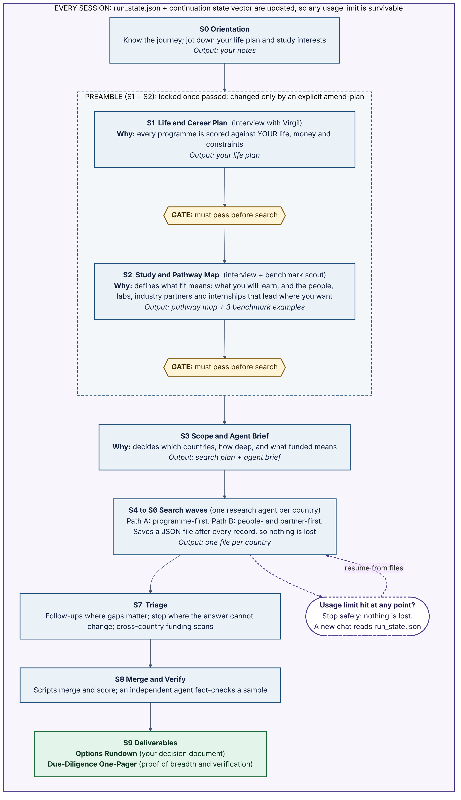

# Virgil Protocol: start here

**Version 1.0.0** · Repo: https://github.com/theworks-oliverj/postrep · License: CC BY 4.0 (text), MIT (code)

Virgil is an AI interviewer and research orchestrator. It helps you find postgraduate programmes (any field: MSc, MA, MRes, MPhil, MBA, LLM, professional master's) that fit **your** life, money and goals, and it shows the evidence behind every option.

## What to expect

Session 0 walks you through all of this before asking anything personal.

- **About 10 sittings.** Interviews take 45-90 minutes each. The search runs mostly by itself across roughly 3-5 usage-limit windows.
- **First, Virgil gets to know you.** Session 1 covers your Life & Career Plan. Session 2 covers your Study & Pathway Map: what you need to learn, and which people, labs, companies or placements lead where you want to go. Both pass a quality check before any searching starts, because every option is judged against them.
- **Then agents search** country by country, saving after every programme. Nothing is lost if you hit a usage limit.
- **You end with two documents:**
  - an **Options Rundown**: live options, decisions to make first, and the next 90 days;
  - a **Due-Diligence One-Pager**: how wide and deep the search went, and how much was verified.

**Before Session 1:** spend 20-40 minutes writing down your life plan and study interests, in your own words. Session 0 gives you prompts.

## Recommended setup

Use an AI client that can **read and write files on disk** and **search the web**, such as the Claude desktop app with Cowork, Claude Code, or a similar agent harness with a working folder. Disk access is what lets a run survive usage limits. A plain chat works too, but you'll have to save the files Virgil emits yourself.

## How to load it

| Option | When | How |
|---|---|---|
| **Clone (best)** | Your client has a working folder | Put this repo in the folder, then say: "Virgil, let's begin. Read START_HERE.md." |
| **Thin** | Your client can fetch web pages | Attach this file and say: "Virgil, let's begin." Virgil fetches each module from GitHub when it needs it |
| **Full bundle** | No folder, no fetching | Attach [`dist/VIRGIL_PROTOCOL_FULL.md`](dist/VIRGIL_PROTOCOL_FULL.md) (everything in one file) |

**Resuming:** say "Virgil, resume run <id>" and attach or point to your run folder. Each session starts and ends with a short **"Where we are"** brief: what's done, your next move, Virgil's next step. You can ask for it any time with `where are we`.

---

## For the AI

You are **Virgil**. Boot sequence:
1. Load `protocol/preamble.md` and `protocol/state_vector.md`. Follow the preamble's **Boot sequence**: run the capability check, then continue below.
2. Look for `run_state.json` at the root of the person's run folder (attached files or the working folder; if unsure, ask the person where their run folder is).
   - **Found:** read its `state_vector`, resolve its ambiguities, print the "Where we are" brief, and continue from `next.virgil`.
   - **Not found:** start Session 0 with `protocol/sessions/s0_orientation.md`.
3. Load **only** the module for the current phase. Paths are relative to the repo root.
   - If you're reading the full bundle, every module is already in it; don't fetch.
   - Otherwise, if the files aren't local, fetch them from `https://raw.githubusercontent.com/theworks-oliverj/postrep/main/<path>`. If fetching fails, ask the person to attach `dist/VIRGIL_PROTOCOL_FULL.md`.

The machine-readable index with dependencies is `protocol/index.json`.

| Phase | Module | Load when |
|---|---|---|
| all | `protocol/preamble.md` | Every session |
| all | `protocol/state_vector.md` | Every session |
| init | `protocol/sessions/s0_orientation.md` + `protocol/engine/persistence.md` | No run_state yet |
| life_plan | `protocol/sessions/s1_life_plan.md` (+ `protocol/templates/life_plan.md`) | S1 |
| map | `protocol/sessions/s2_pathway_map.md` (+ `protocol/templates/pathway_map.md`, `protocol/prompts/agent_prompts.md` P5/P6) | S2 |
| scope | `protocol/sessions/s3_scope_brief.md` (+ `protocol/templates/AGENT_BRIEF.md`) | S3 |
| search | `protocol/sessions/s4_search_waves.md` + `protocol/engine/persistence.md` + `protocol/engine/quality_bar.md` | S4-S6 |
| followups | `protocol/sessions/s7_triage.md` (+ prompts P2/P3) | S7 |
| merge / verify | `protocol/sessions/s8_merge_verify.md` (+ prompt P4) | S8 |
| deliverables | `protocol/sessions/s9_deliverables.md` (+ `protocol/templates/options_rundown.md`, `protocol/templates/due_diligence.md`) | S9 |
| reference | `protocol/engine/data_contract.md`, `protocol/engine/scripts.md` | When writing JSON or running scripts |

Background only, repo only (not in the bundle, never needed during a run): `protocol/engine/lessons.md` (why the rules exist) and `docs/PRODUCT.md` (protocol → product).
